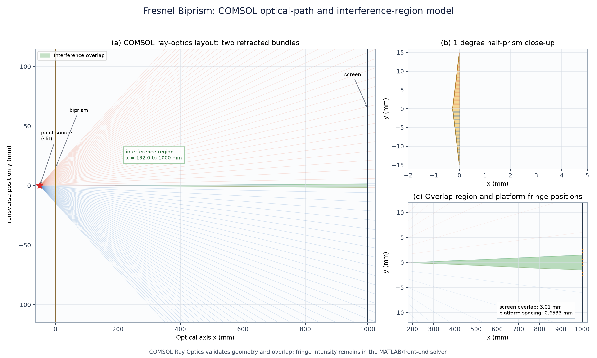
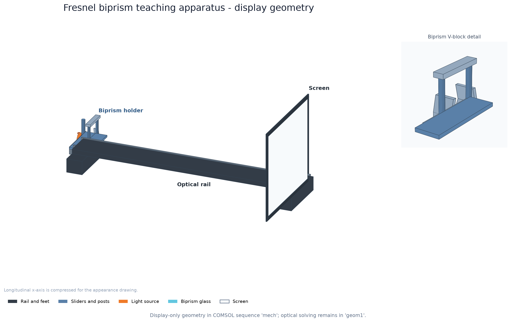
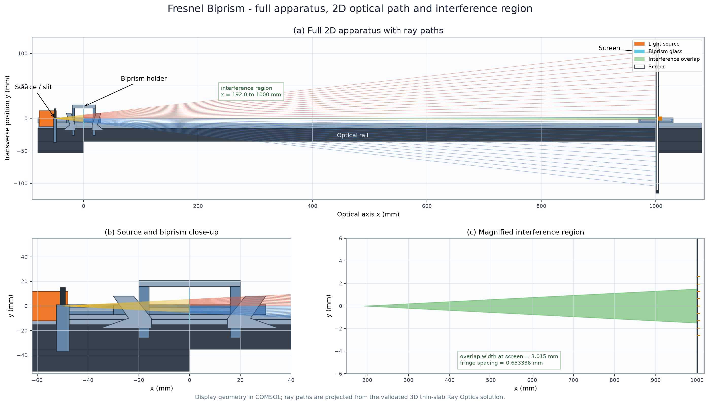

# 菲涅耳双棱镜 COMSOL 光路与干涉区仿真

本目录给出与网页平台同参数口径的 COMSOL Ray Optics 模型。定位不是重复 MATLAB 的条纹强度计算，而是验证几何光学光路、虚光源位置和两束光的干涉交叠区。



## 文件

- `FresnelBiprism_RayOptics.mph`：COMSOL 6.4 模型，已包含几何、材料、Ray Optics 物理场、网格、射线追踪解、轨迹绘图和导出节点。
- `FresnelBiprism_RayOptics_with_appearance.mph`：保留原光学求解，同时新增独立 `mech` 几何序列的机械外观版。
- `FresnelBiprism_2D_View.mph`：完整仪器的二维展示模型，包含三组光线曲线、光屏刻度和绿色干涉区。
- `FresnelBiprism_OpticalPath_Interference.png`：三视图汇总，展示全光路、棱镜放大和屏前干涉区。
- `FresnelBiprism_Apparatus_Appearance.png`：教学示意版机械装置外观图。
- `FresnelBiprism_2D_View.png`：二维全仪器、光路和干涉区总览图。
- `FresnelBiprism_RayOptics.png`：COMSOL 直接导出的三维射线轨迹图。
- `FresnelBiprism_RayOptics.txt`：射线轨迹原始数据，可用 Excel、MATLAB 或 Python 继续分析。
- `FresnelBiprism_metrics.json`：平台与 COMSOL 的数值对比指标。
- `build_fresnel_biprism.py`：从零建立并求解模型。
- `postprocess_fresnel_biprism.py`：添加 Ray 数据集、绘图和导出。
- `analyze_rays.py`：识别折射光线、拟合虚光源并计算干涉重叠区。
- `plot_results.py`：生成上面的三视图汇总和指标 JSON。
- `add_mechanical_appearance.py`：创建机械外观版 `.mph`。
- `render_appearance.py`：生成机械装置外观图。
- `verify_appearance.py`：验证外观序列存在且光学解没有丢失。
- `build_2d_view.py`：生成二维 COMSOL 展示模型和三组 sectionwise 光线数据。
- `render_2d_view.py`：生成二维全仪器光路总览图。
- `verify_2d_view.py`：验证二维模型、光线曲线、干涉区和原模型完整性。

## 参数口径

| 参数 | 数值 |
|---|---:|
| 波长 λ | 589.3 nm |
| 玻璃折射率 n | 1.5168 |
| 单侧棱镜角 β | 1.0° |
| 点光源到棱镜 z₁ | 50 mm |
| 棱镜到光屏 z₂ | 950 mm |
| 棱镜半高 H | 15 mm |
| 棱镜厚度 | 2 mm |

## 数值结果

网页平台的傍轴公式给出：

```text
d = 2 z₁ (n - 1) tan(β) = 0.901986 mm
Δx = λ (z₁ + z₂) / d = 0.653336 mm
```

COMSOL 对出射光线做最小二乘虚光源拟合：

| 孔径 | COMSOL 虚光源间距 d | 与平台偏差 |
|---|---:|---:|
| `|y| ≤ 3 mm` | 0.898786 mm | -0.355% |
| `|y| ≤ 5 mm` | 0.897190 mm | -0.531% |
| `|y| ≤ 10 mm` | 0.887233 mm | -1.636% |
| 全孔径 `|y| ≤ 14.5 mm` | 0.871385 mm | -3.393% |

结论：在平台采用的傍轴口径下，COMSOL 与平台虚光源间距相差约 **0.35%**，说明网页平台的几何参数传递和傍轴公式实现是正确的。口径放大后偏差增至约 3.4%，主要来自球面像差和非傍轴入射，不是平台算错。

COMSOL 还给出干涉区：

- 两束折射光从 `x ≈ 192 mm` 开始在轴附近交叠。
- 光屏位于 `x = 1000 mm`。
- 屏面干涉重叠区约为 `y = -1.507 ~ +1.507 mm`，宽度约 **3.015 mm**。
- 在平台给出的 Δx = 0.6533 mm 下，±3 mm 视野约可容纳 **9 条**亮纹间隔。

## 与 MATLAB 的分工

- COMSOL：点光源、双棱镜折射、上下两束光、虚光源位置、光屏落点、干涉交叠区域。
- MATLAB / 网页平台：双光束复振幅叠加、条纹强度、条纹间距、三种波长解算方法和不确定度。

因此 COMSOL 负责“光怎么走、在哪里交叠”，MATLAB/网页负责“交叠区里的条纹长什么样、由条纹反算什么”。

## 打开与复现

直接双击 `FresnelBiprism_RayOptics.mph`，打开 `Ray Tracing Study` 的解和 `Fresnel Biprism Ray Trajectories` 绘图组即可查看。

在本目录重新生成：

```powershell
python build_fresnel_biprism.py
python postprocess_fresnel_biprism.py
python analyze_rays.py
python plot_results.py
```

`build_fresnel_biprism.py` 使用 `mph.Client(cores=1)` 启动 COMSOL 6.4 独立客户端。当前模型网格约 1828 个四面体单元；由于 2 mm 薄片和楔形尖端，网格器会给出薄区域提示，但射线追踪求解已完成并保存结果。

## 在 COMSOL 中查看光路

1. 打开 `FresnelBiprism_RayOptics.mph`。
2. 在模型树中展开 `结果`，点击 `Fresnel Biprism Ray Trajectories`。
3. 点击 `射线轨迹 1`，把颜色表达式设为 `gop.L`，可看到光程长度彩色光路。
4. 右键 `Ray Tracing Study`，选择计算；再右键轨迹绘图组，选择绘制。
5. 图形窗口使用 `视图 > 正投影` 或切换到 `xy` 视角，便于看上下两束光的交叉和分离。

模型树中的关键字：

- `Geometrical Optics > Slit point source fan`：点光源、扇形方向和波长。
- `Geometrical Optics > Glass-air interfaces`：玻璃-空气折射面。
- `Ray Tracing Study`：射线追踪求解。
- `结果 > Fresnel Biprism Ray Trajectories`：射线轨迹图。

## 机械装置外观模型

打开 `FresnelBiprism_RayOptics_with_appearance.mph`：

1. 在模型树展开 `组件 1 > 几何 2`，标签为 `mech`。
2. 右键 `几何 2`，选择构建全部。
3. 点击 `几何 2`，在图形窗口切换 3D 视图，可看到导轨、支脚、三个滑块、光源、V 形夹爪和实体光屏。
4. `几何 1` 仍是原光学计算域；它和 `mech` 是两个独立几何序列。

机械件仅用于显示，没有材料、物理场或网格。原 `Ray Tracing Study`、`解 1` 和轨迹绘图均保留。

外观预览：



## 二维全仪器光路与干涉区

打开 `FresnelBiprism_2D_View.mph`，在模型树点击 `几何`，即可看到：

- 完整二维仪器：导轨、光源、双棱镜夹持架和光屏。
- 黄色的点光源入射扇形。
- 橙红色的上半棱镜折射束。
- 蓝色的下半棱镜折射束。
- 绿色干涉交叠区。
- 光屏上的 9 个条纹位置刻度。

二维模型使用 `Form Assembly`，因此仪器、光线和干涉区不会被合并，颜色能够分别保留。



重新生成：

```powershell
python build_2d_view.py
python render_2d_view.py
python verify_2d_view.py
```

二维模型是展示模型；光线由已验证的 3D 薄片 Ray Optics 结果投影得到。COMSOL 6.4 当前环境创建原生 2D `Geometrical Optics` 接口会触发内部 `StackOverflowError`，因此不使用该接口重新求解。

## 查看干涉区

COMSOL 的 `Ray Trajectories` 显示的是几何光线，绿色干涉交叠区是由光线包络后处理得到的，不是 COMSOL 原生材料区域。运行：

```powershell
cd D:\cc\test-1\comsol
python analyze_rays.py
python plot_results.py
```

打开 `FresnelBiprism_OpticalPath_Interference.png`，图中绿色区域就是两束折射光在轴附近的交叠区。

## 快速排错

- 如果射线是一条直线：检查 `Slit point source fan` 的 `TransverseDirection` 和 `et`，当前应为 `et = (0,1,0)`，即扇形位于 `x-y` 截面。
- 如果玻璃中没有折射：检查 `Glass-air interfaces` 是否选中全部边界，材料折射率是否为 `1.5168`。
- 如果只有中间几条光线：增大 `Nw`，或检查 `fan_angle = atan(1.25*H/a)`。
- 如果三维图看不清：先用 `plot_results.py` 生成的二维三视图；它已经做了坐标投影和干涉区着色。
